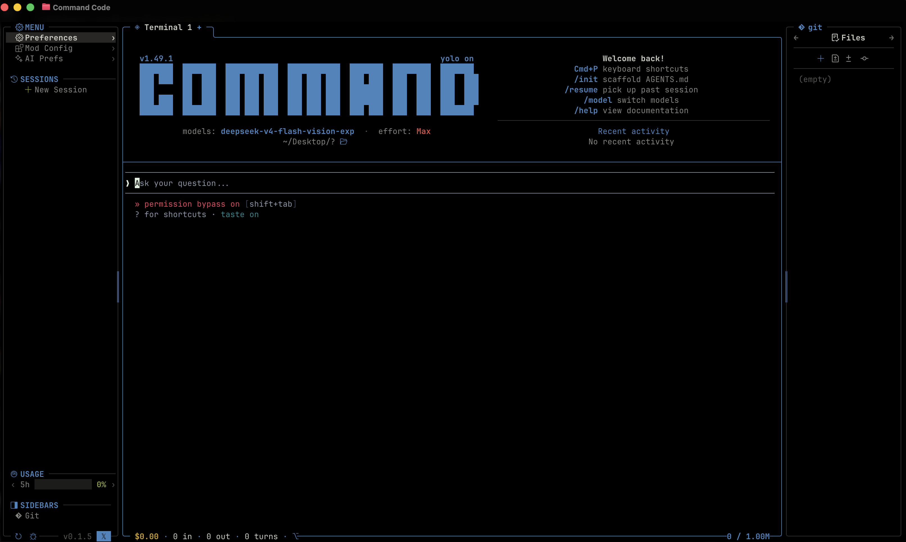
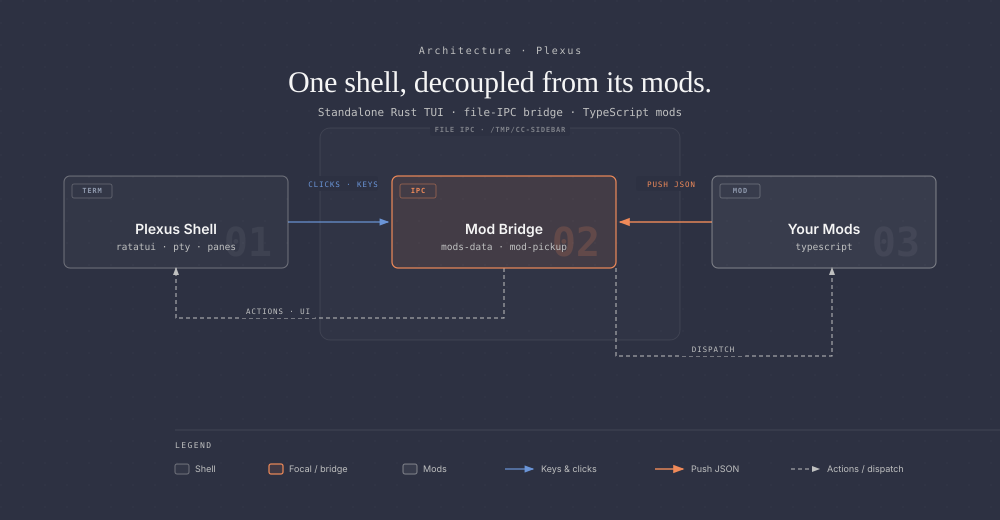

<p align="center">
  <picture>
    <source media="(prefers-color-scheme: dark)" srcset="./assets/hero-dark.svg" />
    <source media="(prefers-color-scheme: light)" srcset="./assets/hero-light.svg" />
    
  </picture>
</p>

<p align="center">
  <a href="https://github.com/Azertyuiop442/Plexus/releases"><picture><source media="(prefers-color-scheme: dark)" srcset="https://shieldcn.dev/badge/plexus-v0.1.6-4485be.svg?logo=rust&variant=outline" /><source media="(prefers-color-scheme: light)" srcset="https://shieldcn.dev/badge/plexus-v0.1.6-285987.svg?logo=rust" /></picture></a>
  <a href="https://github.com/Azertyuiop442/Plexus"><picture><source media="(prefers-color-scheme: dark)" srcset="https://shieldcn.dev/github/stars/Azertyuiop442/Plexus.svg?variant=outline" /><source media="(prefers-color-scheme: light)" srcset="https://shieldcn.dev/github/stars/Azertyuiop442/Plexus.svg?color=1f2328" /></picture></a>
  <a href="LICENSE.md"><picture><source media="(prefers-color-scheme: dark)" srcset="https://shieldcn.dev/badge/License-Fair_%26_Community-4485be.svg?variant=outline" /><source media="(prefers-color-scheme: light)" srcset="https://shieldcn.dev/badge/License-Fair_%26_Community-285987.svg" /></picture></a>
</p>

<p align="center">
  
</p>

---

<a id="01-architecture--mod-bridge"></a>
<p align="center">
  <picture>
    <source media="(prefers-color-scheme: dark)" srcset="./assets/div-01-dark.svg" />
    <source media="(prefers-color-scheme: light)" srcset="./assets/div-01-light.svg" />
    
  </picture>
</p>

Plexus acts as a presentation shell decoupled from background logic. Companion mods and background services communicate non-blockingly via JSON file-IPC in `/tmp/cc-sidebar/`:

- `mods-data/<mod>.json`: Mods push live widgets, metrics, and modals.
- `mod-pickup.json`: Plexus routes user clicks and triggers back to the active mod.

<p align="center">
  
</p>

---

<a id="02-features"></a>
<details>
<summary><picture><source media="(prefers-color-scheme: dark)" srcset="./assets/div-02-dark.svg" /><source media="(prefers-color-scheme: light)" srcset="./assets/div-02-light.svg" /></picture></summary>
<div align="left">
<br/>

- **Decoupled Multiplexing**: Native Rust PTY terminal multiplexer with persistent tabs, background process isolation, and hot reload (<kbd>Ctrl</kbd>+<kbd>R</kbd>).
- **Data-Driven Mod Bridge**: Companion mods and background services push live widgets, metrics, and interactive modals via JSON IPC (`/tmp/cc-sidebar/`).
- **Autonomous Agent Skills**:
  - Install skill bundles directly from any GitHub repository URL.
  - Live remote git tracking: automatically checks upstream commit freshness and flags updates.
  - One-click in-app background updater with progress indicators and automatic context injection.
- **Configurable Sound Alerts**:
  - Audio cues on task completion and user intervention / permission prompts.
  - Native, zero-latency playback on macOS (`afplay`), Windows (`PowerShell` / SystemSounds), and Linux (`paplay` / `pw-play`).
  - Anti-duplication run latch and global debounce cooldown to eliminate audio overlap across multiple open terminals.
  - Dedicated configuration modal with live sound preview and test triggers.
- **Transient Error Recovery & Auto-Retry**:
  - Real-time classifier for provider rate limits (429), server outages (5xx), and network drops.
  - Configurable exponential backoff, jitter, and interrupt safety.
- **Live Usage Telemetry**:
  - Interactive 1-line ASCII gauge tracking usage limits (5-hour, weekly, and monthly quotas).
- **Self-Pulling Update Engine**:
  - In-app version detection with automatic fast-forward updates.

</div>
</details>

---

<a id="03-installation"></a>
<p align="center">
  <picture>
    <source media="(prefers-color-scheme: dark)" srcset="./assets/div-03-dark.svg" />
    <source media="(prefers-color-scheme: light)" srcset="./assets/div-03-light.svg" />
    
  </picture>
</p>

### One-Command Installer

- **macOS / Linux**:
```bash
curl -fsSL https://raw.githubusercontent.com/Azertyuiop442/Plexus/public/install.sh | bash
```

- **Windows (PowerShell)**:
```powershell
irm https://raw.githubusercontent.com/Azertyuiop442/Plexus/public/install.ps1 | iex
```

### Upgrade / Manual Build
```bash
git clone https://github.com/Azertyuiop442/Plexus.git ~/.commandcode/mods/cc-dashboard
cd ~/.commandcode/mods/cc-dashboard
bash install.sh
```

---

<a id="04-keybindings"></a>
<details>
<summary><picture><source media="(prefers-color-scheme: dark)" srcset="./assets/div-04-dark.svg" /><source media="(prefers-color-scheme: light)" srcset="./assets/div-04-light.svg" /></picture></summary>
<div align="center">
<br/>

| Shortcut | Action | Scope |
|:---:|---|:---:|
| <kbd>Ctrl</kbd> + <kbd>P</kbd> | Quick Switcher / Fuzzy Palette | `[Global]` |
| <kbd>Ctrl</kbd> + <kbd>O</kbd> | Process Tree Inspector | `[Global]` |
| <kbd>Ctrl</kbd> + <kbd>B</kbd> | Toggle Left Sidebar | `[Global]` |
| <kbd>Ctrl</kbd> + <kbd>M</kbd> | Maximize / Restore Dock | `[Global]` |
| <kbd>Ctrl</kbd> + <kbd>Space</kbd> | Context Menu | `[Active Pane]` |
| <kbd>Ctrl</kbd> + <kbd>T</kbd> · <kbd>+</kbd> | New Terminal Tab | `[Tab Bar]` |
| <kbd>Ctrl</kbd> + <kbd>W</kbd> · <kbd>x</kbd> | Close Tab | `[Active Tab]` |
| <kbd>Alt</kbd> + <kbd>1</kbd> .. <kbd>9</kbd> | Jump to Tab N | `[Tab Bar]` |
| <kbd>Ctrl</kbd> + <kbd>R</kbd> | Hot Reload Shell | `[Global]` |

</div>
</details>

---

<a id="05-ecosystem--mod-hub"></a>
<p align="center">
  <picture>
    <source media="(prefers-color-scheme: dark)" srcset="./assets/div-05-dark.svg" />
    <source media="(prefers-color-scheme: light)" srcset="./assets/div-05-light.svg" />
    
  </picture>
</p>

<p align="center">
  Discover and install community extensions on the <b><a href="https://github.com/Azertyuiop442/plexus-community-mods">Plexus Community Mods Hub</a></b>.
</p>

---

<h2 align="center">License</h2>

<p align="center">
  Source-available under the <a href="LICENSE.md">Fair &amp; Community License</a>. Free for personal, academic, and open-source use.
</p>

---

<h3 align="center">Want to leave feedback?</h3>

<p align="center">
  <a href="https://peership.dev">
    <picture>
      <source media="(prefers-color-scheme: dark)" srcset="./assets/peership-dark.svg" />
      <source media="(prefers-color-scheme: light)" srcset="./assets/peership-light.svg" />
      
    </picture>
  </a>
</p>

<p align="center">
  <a href="https://x.com/astra442">
    <picture>
      <source media="(prefers-color-scheme: dark)" srcset="https://shieldcn.dev/badge/Follow%20%7C-@astra442-FFFFFF.svg?logo=x&variant=outline" />
      <source media="(prefers-color-scheme: light)" srcset="https://shieldcn.dev/badge/Follow%20%7C-@astra442-1f2328.svg?logo=x" />
      
    </picture>
  </a>
</p>
